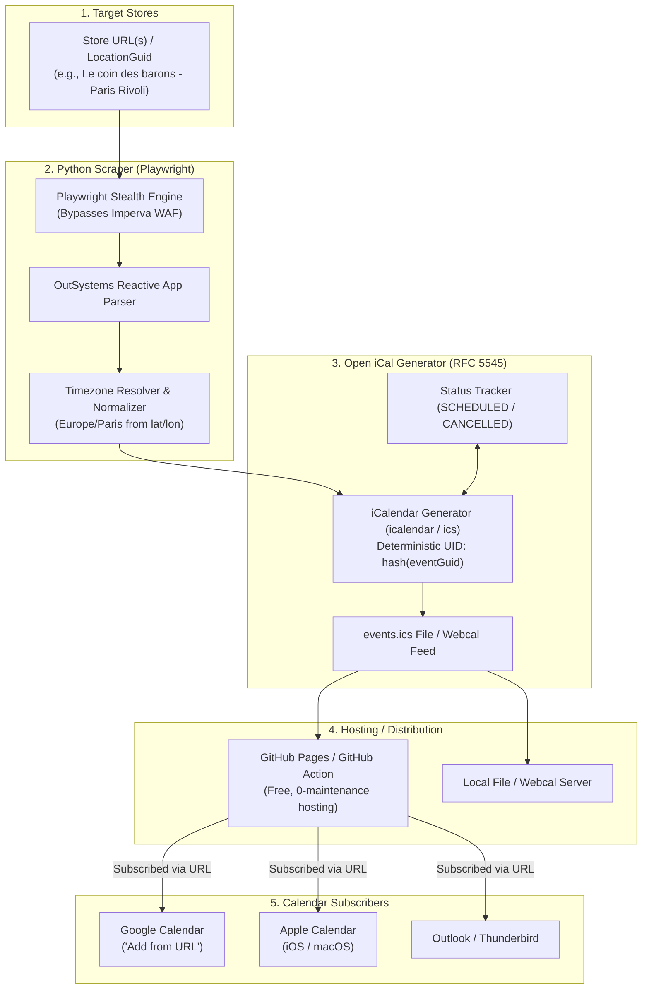

# Technical Specification: PokéCal (Play! Pokémon TCG Event Sync)

**Project Name:** PokéCal  
**Version:** 1.1.0 (Open-Standard iCalendar / Webcal Edition)  
**Language:** Python 3.11+  
**Date:** October 31, 2026  
**Status:** Approved Specification  

---

## 1. Executive Summary & Objective

**PokéCal** is an open-source tool that bridges the official **Play! Pokémon Event Locator** (`events.pokemon.com`) with calendar applications (Google Calendar, Apple Calendar, Outlook) using the **open iCalendar protocol (RFC 5545 / Webcal)**.

Local game stores regularly schedule Pokémon Trading Card Game (TCG) tournaments—such as Weekly Leagues, League Challenges, League Cups, and Prereleases. 

The objective of **v1 (First Draft)** is to:
1. Accept store URLs or store GUIDs (e.g., *Le coin des barons - Paris Rivoli* in Paris, France).
2. Fetch, parse, and normalize all upcoming Pokémon TCG events scheduled at those stores.
3. Generate a standardized **iCalendar (`.ics`) feed** that users can subscribe to directly in Google Calendar (via *"Add from URL"*) without requiring Google Cloud API keys, OAuth screens, or complex authentication.
4. Support automated publishing (e.g., GitHub Pages via GitHub Actions or local export).

---

## 2. Open-Standard Architecture (RFC 5545 / Webcal)

Instead of requiring proprietary Google Cloud credentials, PokéCal leverages the universal open calendar standard:



### Why RFC 5545 (`.ics`) for Google Calendar?
1. **Zero Configuration for End-Users:** In Google Calendar, click **"Other calendars" (+) → "From URL"**, paste the link, and you are done.
2. **No Google Cloud API Requirements:** No Google Developer Console, no OAuth consent approval process, no service account JSON credentials.
3. **Cross-Platform:** Works simultaneously on Google Calendar on Android, Apple Calendar on iOS/macOS, and desktop clients like Thunderbird.
4. **Idempotent by Design:** The `UID` field in RFC 5545 guarantees that events are updated cleanly when refreshed, preventing duplicate calendar entries.

---

## 3. Source Website Technical Analysis (`events.pokemon.com`)

### 3.1 Website Architecture
- **Framework:** OutSystems Reactive Web Platform (`window.OutSystemsApp = { basePath: '/EventLocator/' }`).
- **Rendering:** Single Page Application (SPA). The HTML skeleton contains minimal static markup; event cards are fetched asynchronously via client scripts.
- **WAF / Anti-Bot:** Protected by **Imperva Incapsula / Distil Networks**. Raw HTTP clients (curl, basic requests) trigger an anti-bot challenge script.
- **Solution:** Python **Playwright** with stealth options to evaluate JavaScript, satisfy the challenge, and scrape the fully-rendered event components or intercept internal JSON responses.

### 3.2 URL Parsing & Target Parameters
Sample URL:
`https://events.pokemon.com/EventLocator/LocationDetail?EventDetailGUID=&range=25&latitude=48.8575475&startdate=2026-11-07&LocationGuid=d31263f1-80fb-0a60-8b04-72c8887c24f2&storename=LE+COIN+DES+BARONS+-+PARIS+RIVOLI&iskm=false&locale=fr-FR&LocationName=LE+COIN+DES+BARONS+-+PARIS+RIVOLI&longitude=2.3513765`

Extracted metadata:
- `LocationGuid`: Store GUID (`d31263f1-80fb-0a60-8b04-72c8887c24f2`)
- `storename`: Store Name (`LE COIN DES BARONS - PARIS RIVOLI`)
- `latitude` & `longitude`: Geolocation (`48.8575475`, `2.3513765`)
- `locale`: Format locale (`fr-FR`)
- `startdate`: Lookahead date

---

## 4. Timezone & Locale Resolution

Pokémon event locator displays start times in the **local time of the store venue**.
If an event starts at 19:00 at Le coin des barons - Paris Rivoli (Paris, France), it must be encoded with the `Europe/Paris` timezone (UTC+1 in winter, UTC+2 in summer).

- **Offline Timezone Detection:** PokéCal uses `timezonefinder` in Python to convert store coordinates (`latitude`, `longitude`) directly to an IANA timezone identifier (`Europe/Paris`) without requiring external API keys.
- **RFC 5545 Timezone Definition:** The generated `.ics` file includes a standard `VTIMEZONE` block so Google Calendar renders the event at the correct time in any user's local timezone.

---

## 5. iCalendar Specification & Event Mapping

Each tournament is rendered as a standard `VEVENT` block:

```text
BEGIN:VCALENDAR
VERSION:2.0
PRODID:-//PokéCal//Play Pokémon TCG Calendar//EN
CALSCALE:GREGORIAN
METHOD:PUBLISH
X-WR-CALNAME:Pokémon TCG - Le coin des barons - Paris Rivoli
X-WR-TIMEZONE:Europe/Paris

BEGIN:VEVENT
UID:pokemon-tcg-d31263f1-80fb-0a60-8b04-72c8887c24f2@pokecal
DTSTAMP:20261031T204500Z
DTSTART;TZID=Europe/Paris:20261107T190000
DTEND;TZID=Europe/Paris:20261107T230000
SUMMARY:🏆 [TCG] League Challenge - Le coin des barons - Paris Rivoli
LOCATION:LE COIN DES BARONS - PARIS RIVOLI, Paris, France
DESCRIPTION:Format: Standard\nEntry Fee: 12.00 €\nEvent Type: League Challenge\nRegistration: On-site\n\nOfficial Link: https://events.pokemon.com/EventLocator/LocationDetail?EventDetailGUID=...\n\nSynced by PokéCal
URL:https://events.pokemon.com/EventLocator/LocationDetail?EventDetailGUID=...
STATUS:CONFIRMED
CATEGORIES:Pokemon,TCG,Tournament
END:VEVENT

END:VCALENDAR
```

### Deterministic Deduplication
- `UID`: Format is `pokemon-tcg-{LocationGuid}-{EventDate}-{EventHash}@pokecal`.
- When an event time changes or is updated, the same `UID` is preserved with an incremented `SEQUENCE: 1` number. Google Calendar will automatically update the existing event rather than creating a duplicate.

---

## 6. Python Tech Stack & Dependencies

| Component | Library | Purpose |
| :--- | :--- | :--- |
| **Scraping Engine** | `playwright` + `playwright-stealth` | Headless browser to bypass Imperva & render OutSystems SPA. |
| **Calendar Generator** | `icalendar` | Clean, compliant RFC 5545 `.ics` formatting. |
| **Data Validation** | `pydantic` | Type-safe models for Stores and Pokémon Events. |
| **Timezone Lookup** | `timezonefinder` + `pytz` | Offline coordinate-to-timezone mapping. |
| **Date Parsing** | `dateparser` | Multi-language parsing (handles French dates e.g. "samedi 7 novembre"). |
| **CLI / Interface** | `typer` / `rich` | Beautiful command-line interface. |

---

## 7. Configuration Specification

Favorite stores are stored per Discord user (snowflake ID, as text) in Postgres: a `users` table and a `user_stores` table (`discord_id`, `location_guid`, `name`, `url`, `enabled`, `filters` JSONB). Access goes through the `StoreRepository` protocol in `pokecal/db.py`.

Environment: `DATABASE_URL` or `POSTGRES_*` for the connection; `POKECAL_OUTPUT_DIR`, `POKECAL_CALENDAR_NAME`, `POKECAL_CALENDAR_DESCRIPTION`, `POKECAL_DEFAULT_TIMEZONE` for output. One feed is written per user at `<output dir>/<discord_user_id>.ics`.

---

## 8. Implementation Plan & Milestones

### Milestone 1: Project Setup & URL Parser
- Initialize Python environment with `uv` or `pip`.
- Implement URL parser to extract `LocationGuid`, `storename`, `latitude`, `longitude`, `locale`.
- Implement coordinate-to-timezone resolver.

### Milestone 2: Playwright Scraper for OutSystems
- Setup Playwright stealth session to navigate to store page.
- Wait for event cards to hydrate.
- Extract tournament metadata (Title, Format, Date, Start/End times, Cost, Details URL).

### Milestone 3: RFC 5545 iCalendar Generator
- Build `PokemonTcgEvent` to `VEVENT` serializer.
- Add deterministic `UID` generation for zero duplicates.
- Export standard `pokecal.ics`.

### Milestone 4: GitHub Actions Automated Publishing
- Add `.github/workflows/sync.yml` to run the script once every 24 hours.
- Publish `pokecal.ics` to GitHub Pages for zero-cost, maintenance-free Google Calendar subscription.
